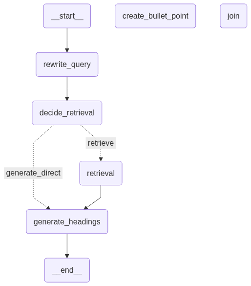
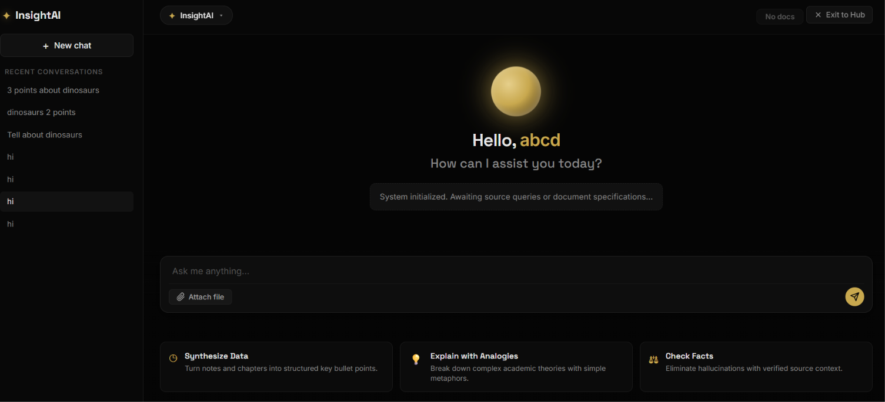
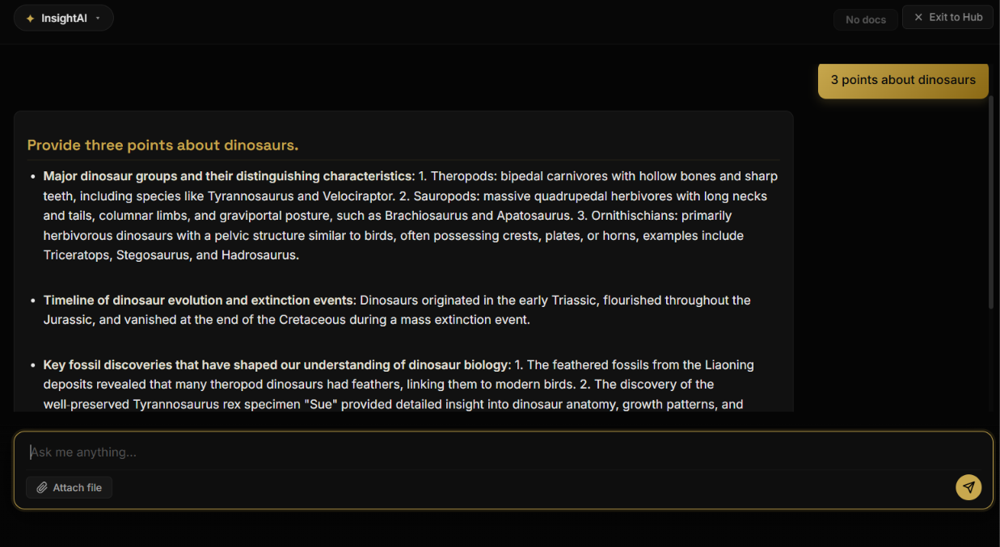
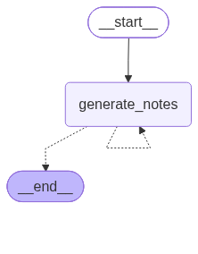
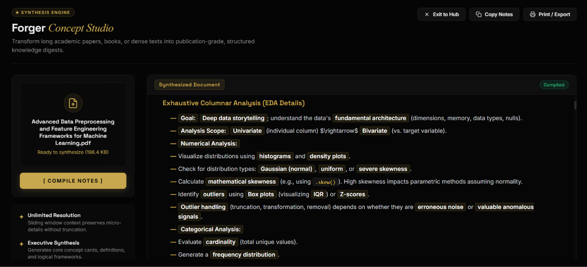
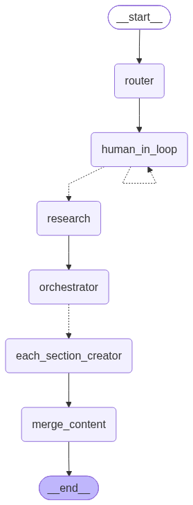
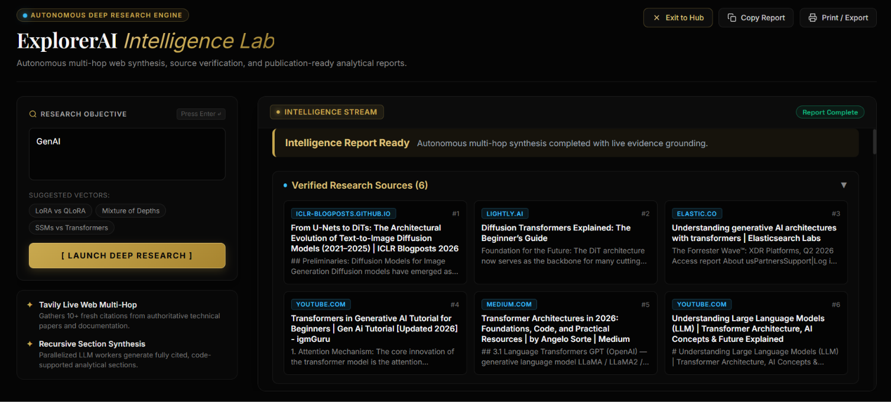
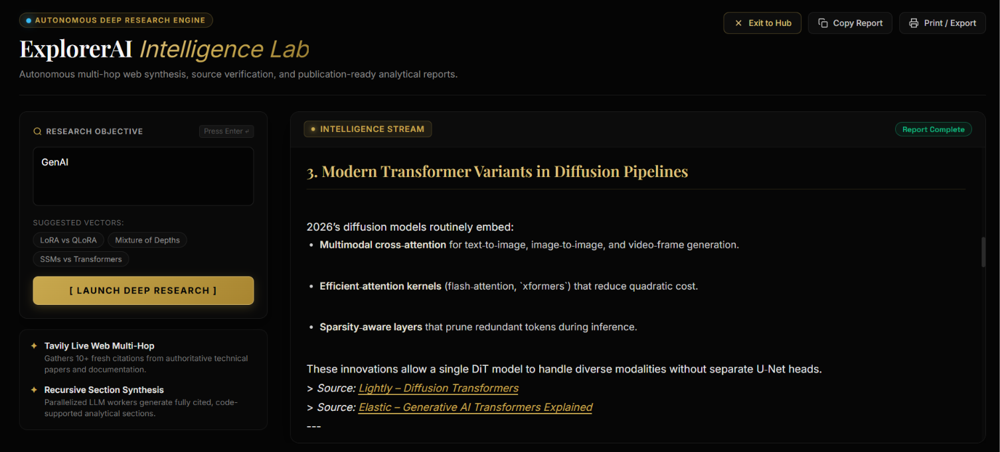
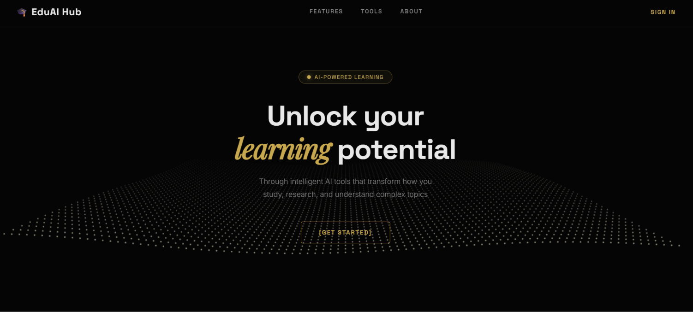

<p align="center">
  
</p>

<h1 align="center">EduAI Hub 🎓</h1>

<p align="center">
  <b>Autonomous Multi-Agent Knowledge & Research Platform</b><br>
  <i>Empowering students, researchers, and professionals with reliable LangGraph workflows, grounded document RAG, notebook synthesis, and human-in-the-loop deep web research.</i>
</p>

<p align="center">
  
  
  
  
  
  
  
</p>

---

## 📑 Table of Contents

- [Overview](#-overview)
- [Multi-Agent System Architecture](#-multi-agent-system-architecture)
  - [1. InsightAI: Context & Verified RAG Agent](#1-insightai-context--verified-rag-agent)
  - [2. Forger: Long-Document Notebook Synthesizer](#2-forger-long-document-notebook-synthesizer)
  - [3. ExplorerAI: Autonomous Deep Research Agent](#3-explorerai-autonomous-deep-research-agent)
- [User Experience & Authentication](#-user-experience--authentication)
- [Technology Stack](#-technology-stack)
- [Rendering Agent Workflow Graphs](#-rendering-agent-workflow-graphs)
- [Local Setup & Installation](#-local-setup--installation)
- [Environment Configuration](#-environment-configuration)
- [Project Directory Structure](#-project-directory-structure)

---

## 🌟 Overview

**EduAI Hub** is an agentic AI platform engineered for reliable, grounded document comprehension and structured deep research. Rather than relying on simple prompt chaining, EduAI Hub models each cognitive task as an asynchronous, stateful directed graph using **LangGraph**.

### Core Value Pillars:
- **Reliable Grounded Retrieval:** Context agents evaluate queries and determine whether retrieval from verified vector storage is necessary before generating answers.
- **Long Document Handling:** Sliding-window notebook synthesizers break down lengthy textbooks and papers into coherent sections without exceeding context boundaries.
- **Distributed Workload Balancing:** Deep research divides cognitive steps (query expansion, parallel section drafting, and final synthesis) across specialized models to maintain high reliability and avoid rate limits.
- **Human-in-the-Loop Alignment:** Researchers can inspect, modify, and select search queries before external research is executed.

---

## 🤖 Multi-Agent System Architecture

### 1. InsightAI: Context & Verified RAG Agent

InsightAI handles document Q&A and factual inquiries with structured pedagogical responses, including analogies, definitions, and practical examples.

#### LangGraph Workflow:
1. **Query Rewriting (`rewrite_query`)**: Standardizes input and clarifies user intent.
2. **Decision Gateway (`decide_retrieval`)**: Dynamically decides whether document retrieval from Pinecone is required (`route_after_decide`).
3. **Semantic Retrieval (`retrieval`)**: Dense vector semantic similarity search using HuggingFace embeddings against Pinecone.
4. **Heading Decomposition (`generate_headings`)**: Breaks the question down into logical pedagogical sections.
5. **Parallel Worker Fan-Out (`create_workers`)**: Employs LangGraph map-reduce (`Send` primitive) to generate verified bullet points for each section concurrently.
6. **Synthesis Join (`join`)**: Unifies worker findings into a clean, structured markdown response.

<table align="center" width="100%">
  <tr>
    <th width="35%">Agent Graph Architecture</th>
    <th width="65%">Live Chatbot UI Execution</th>
  </tr>
  <tr>
    <td align="center" valign="top">
      
      <br><sub><b>Figure 1.1:</b> Context Agent LangGraph DAG</sub>
    </td>
    <td align="center" valign="top">
      <br><br>
      
      <br><sub><b>Figure 1.2:</b> InsightAI interactive interface & structured pedagogical synthesis</sub>
    </td>
  </tr>
</table>

---

### 2. Forger: Long-Document Notebook Synthesizer

Forger ingests documents, lecture transcripts, and papers to generate comprehensive revision guides and study notes without losing key details.

#### LangGraph Workflow:
1. **Document Ingestion**: Uses **Docling** to parse documents, tables, and formatted text.
2. **Sliding Context Partitioning**: Slices parsed content into coherent contextual windows.
3. **Cyclic Note Generation Loop (`generate_notes`)**: Iteratively extracts definitions, highlights core principles, and merges insights with previous windows.
4. **Conditional Loop Router (`route_next`)**: Recursively routes back to `generate_notes` until all windows are processed.

<table align="center" width="100%">
  <tr>
    <th width="30%">Agent Graph Architecture</th>
    <th width="70%">Live Synthesis UI</th>
  </tr>
  <tr>
    <td align="center" valign="top">
      
      <br><sub><b>Figure 2.1:</b> Notebook Agent Cyclic LangGraph State Machine</sub>
    </td>
    <td align="center" valign="top">
      
      <br><sub><b>Figure 2.2:</b> Forger synthesis dashboard generating formatted study notes</sub>
    </td>
  </tr>
</table>

---

### 3. ExplorerAI: Autonomous Deep Research Agent

ExplorerAI coordinates autonomous deep research. It decomposes research topics, pauses for user review, gathers live web evidence via Tavily, and compiles comprehensive reports.

#### LangGraph Workflow:
1. **Objective Router (`router`)**: Analyzes the research brief and decomposes it into high-signal search queries.
2. **Human-in-the-Loop Checkpoint (`human_in_loop`)**: Uses LangGraph checkpointer memory to pause execution, allowing users to review and adjust target search queries.
3. **Web Evidence Gathering (`research`)**: Executes selected queries through Tavily Search API, extracting top source content.
4. **Section Orchestrator (`orchestrator`)**: Plans multi-section report outlines with specific section briefs.
5. **Parallel Section Workers (`fanout` ➔ `each_section_creator`)**: Dispatches concurrent section creators mapping raw evidence to in-depth analysis.
6. **Merging & Harmonization (`merge_content`)**: Unifies sections, formats citations, and compiles the final report.

#### ⚡ Distributed LLM Architecture:
To maintain high throughput and reliability across API limits, ExplorerAI divides cognitive tasks across specialized models:
- **Orchestration & Structured Routing:** `qwen/qwen3.8-27b` (Function calling and schema validation)
- **Parallel Section Drafting:** `openai/gpt-oss-120b` (Contextual writing and technical reasoning)
- **Synthesis & Deduplication:** `openai/gpt-oss-20b` (Document assembly and citation mapping)

<table align="center" width="100%">
  <tr>
    <th width="35%">Agent Graph Architecture</th>
    <th width="65%">Live Research UI & Human-in-the-Loop Curation</th>
  </tr>
  <tr>
    <td align="center" valign="top">
      
      <br><sub><b>Figure 3.1:</b> ExplorerAI Multi-Agent Distributed LangGraph</sub>
    </td>
    <td align="center" valign="top">
      <br><br>
      
      <br><sub><b>Figure 3.2:</b> Interactive query verification modal and final multi-chapter report</sub>
    </td>
  </tr>
</table>

---

## 🖥 User Experience & Authentication

EduAI Hub provides a secure and responsive interface designed for learning and research workflows.

<p align="center">
  
  <br><sub><b>Figure 4:</b> Secure Authentication Portal with Session Management</sub>
</p>

---

## 🛠 Technology Stack

### Backend & API
- **FastAPI**: Asynchronous high-performance RESTful API endpoints.
- **Uvicorn**: ASGI production server.
- **Pydantic**: Structured data validation and settings management.
- **SQLAlchemy**: Relational ORM for user profiles, histories, and chats.
- **PostgreSQL / SQLite**: Transactional persistence.
- **Passlib / Argon2 & Python-Jose**: Secure password hashing and signed JWT authentication.

### Orchestration & AI Engine
- **LangGraph**: Stateful multi-agent cyclic and conditional workflow graphs.
- **LangChain Core & Community**: Composable chains, runnables, and prompts.
- **Groq API**: High-throughput inference for open-weights models (`qwen/qwen3.8-27b`, `openai/gpt-oss-120b`, `openai/gpt-oss-20b`).
- **NVIDIA AI Endpoints**: Alternative inference engine for Nemotron models.
- **Tavily Search API**: Web retrieval engine for research queries.

### Vector Search & Document Understanding
- **Pinecone Vector Database**: Managed vector store with cosine similarity index.
- **HuggingFace Sentence Transformers**: Dense semantic text embeddings.
- **Docling & PyMuPDF**: Document parser for PDF, DOCX, and text files.

### Frontend
- **HTML5 & Vanilla ECMAScript (ES6+)**: Lightweight, zero-framework client application.
- **Modern CSS3**: Responsive styling, dark luxury aesthetic, and micro-animations.
- **KaTeX**: Math and formula rendering.
- **Marked.js & Highlight.js**: Markdown formatting and syntax highlighting.

---

## 📊 Rendering Agent Workflow Graphs

EduAI Hub includes built-in graph visualization utilities that extract the compiled LangGraph instances and export PNG architecture diagrams via Mermaid.

### Render All Agents:
```bash
python get_graph.py
```
*Generated files:*
- `context_agent_graph.png`
- `notebook_agent_graph.png`
- `research_agent_graph.png`

### Render an Individual Agent:
```bash
# Render Context Agent
python -m app.agents.context_agent.render_graph

# Render Notebook Agent
python -m app.agents.notebook_agent.render_graph

# Render Research Agent
python -m app.agents.research_agent.render_graph
```

Or provide a custom output path:
```bash
python get_graph.py research path/to/output.png
```

---

## 🚀 Local Setup & Installation

### Prerequisites
- Python 3.10+
- PostgreSQL (or local SQLite for testing)
- API Keys: [Groq](https://console.groq.com/), [Pinecone](https://www.pinecone.io/), [Tavily](https://tavily.com/)

### 1. Clone & Set Up Virtual Environment
```bash
git clone https://github.com/your-username/ai-ed-tech-platform.git
cd ai-ed-tech-platform

# Create virtual environment
python -m venv .venv

# Activate environment
# On Windows:
.venv\Scripts\activate
# On Linux / macOS:
source .venv/bin/activate
```

### 2. Install Dependencies
```bash
pip install -r requirements.txt
```

### 3. Configure Environment Variables
Create a `.env` file in the root directory (see [Environment Configuration](#-environment-configuration)).

### 4. Run the Application
```bash
uvicorn main:app --host 0.0.0.0 --port 8000 --reload
```

Navigate to `http://localhost:8000` to access the platform.

---

## ⚙ Environment Configuration

Create a `.env` file in the root directory (or copy from `.env.example`):

```bash
cp .env.example .env
```

```env
# Pinecone Vector Store
PINECONE_API_KEY=
INDEX_NAME=

# Groq LLM Inference
GROQ_API_KEY=

# PostgreSQL Database Configuration
DATABASE_HOSTNAME=localhost
DATABASE_PORT=5432
DATABASE_PASSWORD=
DATABASE_NAME=
DATABASE_USERNAME=postgres
POSTGRE_DB_URL=postgresql+asyncpg://

# Authentication & JWT Security
SECRET_KEY=
ALGORITHM=
ACCESS_TOKEN_EXPIRE_MINUTES=

# Web Search & Inference Providers
TAVILY_API_KEY=
NVIDIA_API_KEY=
GOOGLE_API_KEY=

# MongoDB Configuration (Optional / Workspace)
MONGO_USERNAME=
MONGO_PASSWORD=
MONGO_CLUSTER=
MONGO_KEY=
```

---

## 📁 Project Directory Structure

```plaintext
1.0 Ed-Tech/
├── app/
│   ├── agents/
│   │   ├── context_agent/         # InsightAI: Verified RAG & Context Agent
│   │   │   ├── graph.py           # LangGraph StateGraph & map-reduce fan-out
│   │   │   ├── nodes.py           # Query rewrite, router, retrieval, & heading nodes
│   │   │   ├── llm.py             # Groq LLM configuration
│   │   │   └── render_graph.py    # Visual graph generator
│   │   ├── notebook_agent/        # Forger: Long-Doc Notebook Synthesizer
│   │   │   ├── graph.py           # Sliding-window cyclic StateGraph
│   │   │   ├── nodes.py           # Note generation logic
│   │   │   └── render_graph.py    # Visual graph generator
│   │   └── research_agent/        # ExplorerAI: Autonomous Deep Research
│   │       ├── graph.py           # Multi-agent graph with checkpoint memory
│   │       ├── nodes.py           # Router, human-in-the-loop, search, & fanout
│   │       ├── config.py          # Distributed LLM load balancer
│   │       └── render_graph.py    # Visual graph generator
│   ├── auth/                      # JWT authentication, hashing, & routes
│   ├── core/                      # Global settings & database connection
│   └── database/                  # SQLAlchemy models & migrations
├── assets/                        # Platform screenshots, graphs, & UI assets
├── frontend_ed_tech/              # Modern Vanilla JS/CSS client application
│   └── frontend/
│       ├── login.html             # Auth portal
│       ├── dashboard.html         # Unified agent workspace
│       ├── dashboard.js           # Multi-agent UI & human-in-the-loop handlers
│       └── style.css              # Custom styling & typography
├── get_graph.py                   # Master CLI utility for LangGraph visual exports
├── main.py                        # FastAPI entrypoint & router aggregation
└── requirements.txt               # Dependencies
```

---

<p align="center">
  Crafted for reliable AI-assisted learning and autonomous research.
</p>
